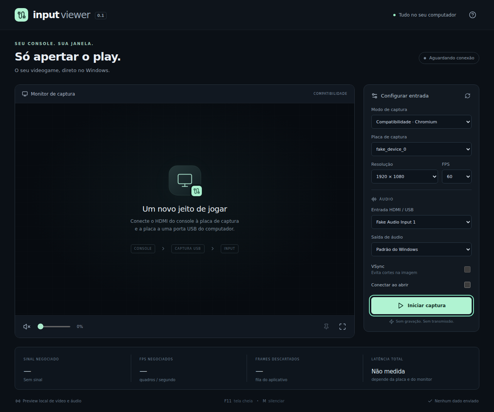

# CoopSeat 0.1

Um visualizador local de placas de captura USB, feito para jogar numa janela do Windows. A captura não é gravada nem transmitida. A conta CoopSeat é opcional e serve para as futuras sessões compartilhadas (watch party).

**Primeira versão experimental.** O frontend foi verificado com uma câmera sintética no Chromium; o núcleo C++ foi compilado e ligado para Windows x64. A captura nativa, a execução do pacote no Windows, o áudio real e a latência fim a fim ainda precisam de teste com hardware. Não há promessa de zero lag ou de compatibilidade universal.

## Abrir e jogar

1. Execute `CoopSeat-0.1.0-Portable.exe` no Windows 10/11 x64. O pacote portátil inclui o Electron e o núcleo nativo; Node.js e Visual Studio não são necessários para usar o app. A primeira abertura pode demorar enquanto ele extrai os arquivos temporários.
2. Conecte o HDMI do console ao **HDMI IN** da captura; conecte o USB da captura ao computador.
3. Feche OBS, Câmera, Discord e outros programas que possam estar usando a placa.
4. No CoopSeat, escolha **Nativo**, a FIFINE e um formato anunciado pelo dispositivo. O padrão automático busca FPS próximo de 60, resolução próxima de 1080p e, em empate, NV12/YUY2 antes de MJPEG.
5. Selecione também **Entrada HDMI / USB** e a saída de som. O app começa **sem áudio** até você escolher a entrada; não ativa o microfone padrão silenciosamente.
6. Clique em **Iniciar captura**. No modo nativo, o vídeo renderizado por Direct3D aparece dentro do próprio painel, na área do monitor de captura.
7. Se o modo nativo não funcionar com sua placa, pare a captura e selecione **Compatibilidade**. Nesse modo o vídeo aparece dentro do painel.

F11 alterna a tela cheia no monitor inteiro; Esc sai da tela cheia e do modo cinema. Com o modo cinema automático ligado (na setinha ao lado do botão Cinema), após alguns segundos sem mexer no teclado ou no mouse durante a captura, os controles somem e o vídeo ocupa a janela; mexer o mouse traz os controles de volta. Na janela do painel, M silencia/restaura o áudio. O botão de alfinete controla Sempre no topo. Resolução, FPS e dispositivos são alterados com a captura parada. Ative “Capturar ao abrir” para reusar a última configuração.

O executável experimental não tem certificado de assinatura de código. Windows/SmartScreen pode indicar editor desconhecido.

## Conta CoopSeat

O botão **Entrar** no cabeçalho conecta o app à conta CoopSeat. Toda a comunicação passa pelo BFF em `https://coopseat.com/api` (repositório `coopseat-web`); o app nunca fala direto com o Supabase.

- **Login**: Google abre o navegador do sistema. O app gera um par PKCE, o BFF devolve um ticket de uso único por `coopseat://auth/callback?ticket=…`, e o app troca ticket + verifier pela sessão. E-mail e senha funcionam direto no app; cadastro e "esqueci minha senha" abrem as páginas do site (o captcha não roda em `file://`).
- **2FA**: se a conta tiver autenticador, o app pede o código de 6 dígitos. Ativar e remover o autenticador também é possível em **Minha conta**.
- **Sessão**: guardada criptografada com `safeStorage` (DPAPI no Windows) em `secure-store.json`, na pasta de dados do app. Se a criptografia do sistema não estiver disponível, o app se recusa a salvar a sessão.
- **Permissões nas sessões**: assistir não exige conta. O chat exige e-mail confirmado, apelido e idade verificada (18+, ECA Digital). Criar salas também exige o 2FA confirmado na sessão, se ele estiver ativado.
- **Deep links**: o app registra o protocolo `coopseat://` e roda em instância única. Só são aceitos `auth/callback`, `auth/linked`, `auth/confirmed` e `auth/verified`; o resto é ignorado. `auth:open` só abre o BFF e os domínios dos provedores de verificação de idade.

O endereço fica em `electron/environments.json`, um por ambiente. `npm run dev` usa `development` (`http://localhost:3000`). O instalador usa `production` (`https://coopseat.com`) e ignora variáveis da máquina. Para testar outro ambiente: `COOPSEAT_ENV=production npm run dev`. Para um endereço avulso, como um preview: `COOPSEAT_BFF_URL=https://seu-preview.exemplo npm run dev`. Esse endereço precisa ser o mesmo `APP_URL` do site naquele ambiente.

## O que está implementado

| Área | Implementação |
|---|---|
| UI | Electron, React, TypeScript e Vite; interface em português |
| Captura nativa | Media Foundation Source Reader assíncrono, `MF_LOW_LATENCY`, modos reais do driver |
| Vídeo | NV12, YUY2, RGB32/ARGB32; MJPEG quando o decoder do Windows consegue entregar um desses formatos |
| Render | Direct3D 11, conversão YUV em shader, letterbox, GPU scaling, swap chain flip-discard |
| Fila | Um sample pendente; frames antigos substituídos pelo mais recente |
| Áudio | WASAPI compartilhado, eventos, captura e reprodução em thread separada; mínimo período de captura quando IAudioClient3 aceita |
| Buffer de áudio | Fila limitada a dois buffers de saída ou 20 ms, o maior; excesso descartado |
| Controles | Dispositivo, modo, entrada/saída de áudio, volume, VSync, tela cheia, modo cinema automático, sempre no topo |
| Persistência | Preferências locais por versão de schema; opção de conexão automática |
| Compatibilidade | `getUserMedia`, `<video>`, entrada de áudio explícita, `setSinkId` para saída |
| Diagnóstico | Resolução/formato, FPS renderizados no nativo, FPS negociados no Chromium, frames descartados na fila nativa |
| Empacotamento | NSIS x64, build local PowerShell/CMake e workflow GitHub Actions |

## Limites técnicos importantes

- A renderização nativa usa **um HWND filho do processo nativo embutido na janela do Electron**, posicionado sobre a área do monitor de captura. Os frames não passam pelo JavaScript; apenas a posição e o tamanho da área são enviados pelo IPC. Por isso nenhum elemento HTML pode ser desenhado por cima do vídeo nativo.
- O menu do Electron é removido fora do modo de desenvolvimento. Em `npm run dev`, mostrar o menu com Alt desloca a página sem mover o vídeo.
- O IPC usa **pipes anônimos privados do processo filho** (`stdin/stdout`, JSON por linha), em vez de um endpoint Named Pipe público. Apenas comandos e estatísticas passam pelo Electron. Vídeo/áudio permanecem no núcleo.
- Existe **upload de CPU para GPU** dos frames do Media Foundation. Não é um caminho zero-copy. NV12/YUY2 têm conversão de cor em shader; MJPEG exige decode, cuja aceleração depende do decoder instalado.
- `MF_LOW_LATENCY` é uma solicitação às partes do pipeline que o suportam; não remove buffers internos do hardware/driver.
- O limite de um sample se aplica à **fila do aplicativo**, não a todas as filas do USB/decoder/GPU.
- Áudio e vídeo priorizam entrega imediata em caminhos independentes. A fila de áudio é limitada para evitar crescimento indefinido; **não há sincronização fina por timestamps, resampling adaptativo de drift ou controle de offset A/V** nesta versão. Sessões longas podem precisar de parar/reiniciar, e descartes/underruns podem produzir estalos.
- WASAPI Exclusive, fallback DirectShow/FFmpeg, HDR, deinterlace, H.264, perfis nomeados e atualização automática **não estão implementados**. Chromium é o fallback disponível.
- VSync é On/Off. Off usa tearing quando DXGI o permite; o compositor/driver ainda pode impor espera. Não há modo Adaptive.
- A seleção de dispositivos é independente em cada backend. Não há fallback silencioso: se um modo falha, o app mostra o erro para você escolher outro.
- Não há recuperação automática de unplug do caminho nativo. Pare/reconecte/atualize/inicie. Mudanças de tipo durante a captura encerram a sessão com erro.
- A latência total aparece como **“Não medida”**. FPS e idade da fila não equivalem a input lag. Compare o preview com HDMI passthrough usando gravação em alta velocidade para medir.
- Conteúdo protegido por HDCP não é exibido. Windows N pode precisar do Media Feature Pack. Drivers UVC, decoder MJPEG e recursos de D3D11 precisam estar presentes.

## Executar pelo código

Instale Node.js 22 LTS ou superior. Este app faz parte de um monorepo (npm workspaces): instale as dependências **na raiz do repositório** e rode os scripts nesta pasta:

```powershell
npm ci          # na raiz
cd coopseat
npm run build
npm start
```

Ou execute `INICIAR.bat`. A pasta `native/build/Release` contém o núcleo x64 compilado por cross-compilation nesta entrega. Se removê-lo, a interface continuará oferecendo o modo Compatibilidade.

Desenvolvimento:

```powershell
npm run dev
```

`npm run dev:web` abre apenas o frontend em localhost, sem os controles nativos do Electron. A política CSP é relaxada apenas no servidor de desenvolvimento para o React Refresh; o build distribuído não permite scripts inline.

## Recompilar o núcleo no Windows

Instale Visual Studio 2022 Build Tools com **Desenvolvimento para desktop com C++**, Windows 10/11 SDK e ferramentas CMake. Abra Developer PowerShell ou deixe CMake no PATH.

```powershell
npm run native:build
npm run build
npm start
```

CMake baixa `nlohmann/json` 3.11.3. O núcleo usa apenas APIs do Windows além dessa biblioteca de headers. O build MSVC configura o runtime C++ estático.

Para gerar o instalador completo:

```powershell
npm run dist
```

Saída: `release/CoopSeat-0.1.0-Setup.exe`.

Para gerar um instalador só com Chromium, sem compilar C++:

```powershell
npm run dist:compat
```

O workflow `.github/workflows/desktop.yml` (na raiz do repositório) recompila o núcleo com MSVC, executa os testes e publica o instalador como artifact do job.

Para lançar uma versão, peça ao agente do Cursor para fazer o release (skill `.cursor/skills/semver-release`). Ele decide o número pela regra de semver, atualiza o `package.json` e o `CHANGELOG.md`, cria o commit e a tag `desktop-vX.Y.Z` e pede confirmação antes do push. Manualmente:

```powershell
node .cursor/skills/semver-release/scripts/release.mjs bump desktop minor
# edite coopseat/CHANGELOG.md, faça o commit, depois:
git tag -a desktop-v0.2.0 -m "desktop 0.2.0"
git push origin main desktop-v0.2.0
```

O workflow confere se a tag bate com o `package.json` e cria uma GitHub Release com o `CoopSeat-<versão>-Setup.exe`, usando a seção da versão no `CHANGELOG.md` como texto, seguida das notas geradas a partir dos commits. O instalador não é assinado, então o Windows SmartScreen exibe um aviso na primeira execução.

## Estrutura

- `src/`: entrada do renderer; liga a ponte do preload (`window.input`) à interface com `configurePlatform`.
- `../packages/ui` (`@coopseat/ui`): interface, seleção de dispositivos e captura Chromium, compartilhadas com o site (`coopseat-web`, rota `/play`).
- `electron/`: processo principal, preload restrito e validação de IPC.
- `native/capture.hpp`: enumeração de modos, captura assíncrona e mailbox de último sample.
- `native/render.hpp`: texturas YUV/RGB, shaders e janela Direct3D 11.
- `native/audio.hpp`: enumeração de endpoints e monitoramento WASAPI.
- `native/main.cpp`: comandos, janela, loop de render e estatísticas.
- `scripts/`: inicialização de desenvolvimento e build Windows.
- `../packages/ui/src/lib/api.ts`, `lib/pkce.ts`, `hooks/useAuth.ts`: cliente do BFF, PKCE e estado da conta.
- `tests/`: validação de comandos encaminhados ao processo nativo, de deep links e de URLs externas.

## Validação desta entrega

Veja `VALIDACAO.md` para os resultados e testes ainda necessários no seu PC.

## Referências de implementação

- [Electron security](https://www.electronjs.org/docs/latest/tutorial/security)
- [Electron session permissions](https://www.electronjs.org/docs/latest/api/session)
- [Media Foundation Source Reader](https://learn.microsoft.com/en-us/windows/win32/medfound/source-reader)
- [MF_LOW_LATENCY](https://learn.microsoft.com/en-us/windows/win32/medfound/mf-low-latency)
- [Source Reader callback](https://learn.microsoft.com/en-us/windows/win32/api/mfreadwrite/nn-mfreadwrite-imfsourcereadercallback)
- [WASAPI initialization](https://learn.microsoft.com/en-us/windows/win32/api/audioclient/nf-audioclient-iaudioclient-initialize)

O código deste projeto é entregue para uso e modificação do usuário. Bibliotecas e runtimes conservam suas próprias licenças, incluídas nas dependências e no pacote Electron.

## Interface



Para reconstruir a versão portátil no Windows:

```powershell
npm run dist:portable
```
